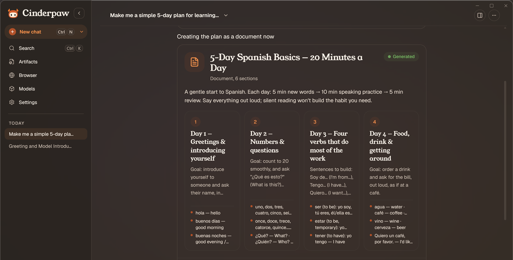
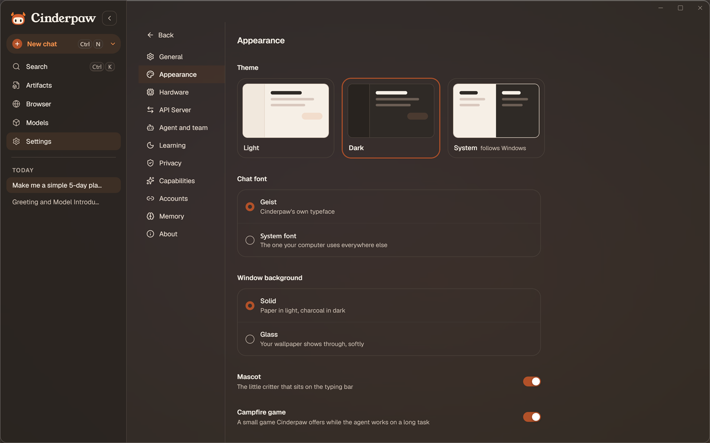
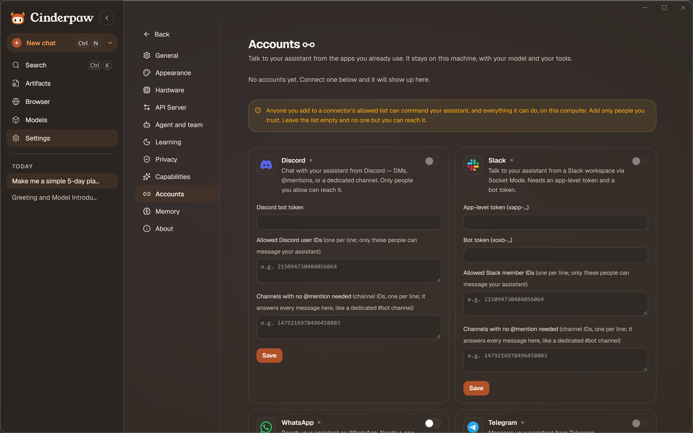
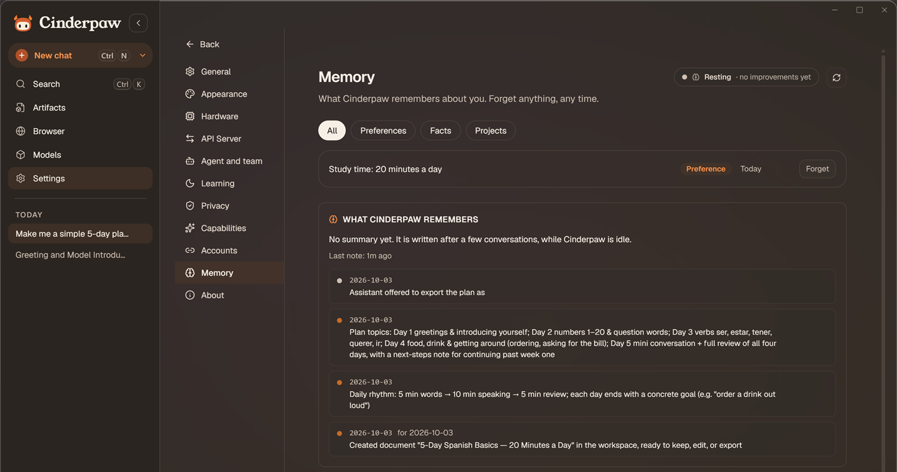
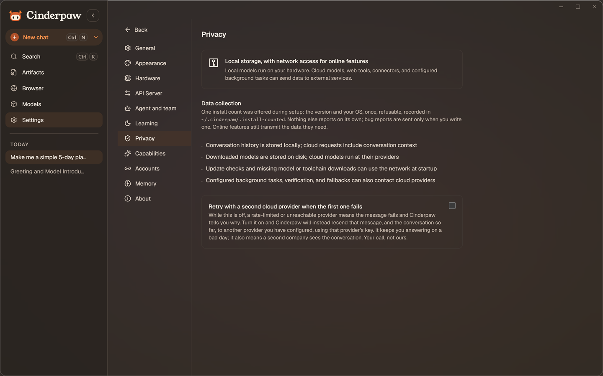
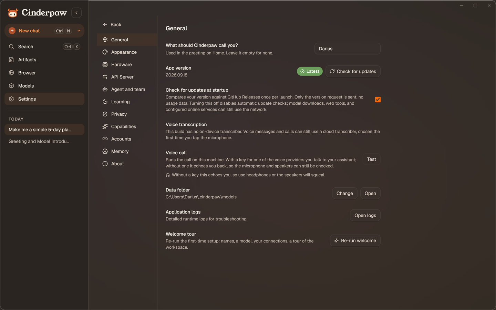
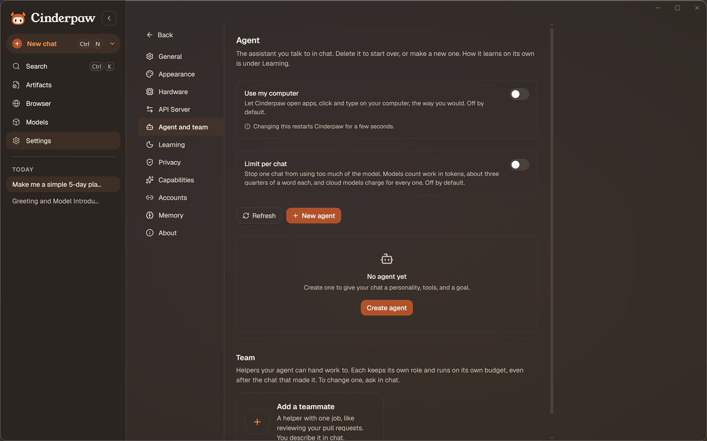

<p align="center">
  
</p>

<p align="center">
  <a href="https://elevenlabs.io/startup-grants">
    <picture>
      <source media="(prefers-color-scheme: dark)" srcset="docs/assets/elevenlabs-grants-on-dark.webp" />
      
    </picture>
  </a>
</p>

<p align="center">
  <b>Cinderpaw has received an <a href="https://elevenlabs.io/startup-grants">ElevenLabs Startup Grant</a>
  and is a member of Anthropic's Claude Startups program.</b>
</p>

<p align="center">
  <a href="https://github.com/bloom500/cinderpaw/releases/latest"></a>
  
  
  
</p>

<p align="center">
  <a href="https://cinderpaw.dev"></a>
  <a href="https://x.com/BloomMedia66730"></a>
  <a href="https://github.com/bloom500/cinderpaw"></a>
  <a href="https://github.com/bloom500/cinderpaw/discussions"></a>
  <a href="https://discord.gg/eqvfVRD6y7"></a>
</p>

[Website](https://cinderpaw.dev) · [Download](https://github.com/bloom500/cinderpaw/releases/latest) · [Report an issue](https://github.com/bloom500/cinderpaw/issues) · [Discussions](https://github.com/bloom500/cinderpaw/discussions) · [What we promise](PROMISES.md) · [Discord](https://discord.gg/eqvfVRD6y7)

---

Cinderpaw is a helper that lives on your computer, does real work with your
files and apps, remembers what matters to you, and tests ways to get better at
it. You talk to it like you would talk to a person.

It opens your files, browses the web in a browser you can watch, answers
messages on Telegram, Discord, Slack or WhatsApp, makes the document, the PDF,
the spreadsheet or the small app you asked for, and then actually sends it. You
can call it and just say the thing out loud; while you talk it can open apps,
play music, copy, paste and take screenshots.

Here is the part that is different. When you stop working, Cinderpaw goes back
over what happened and tries to find a better way to do it next time. It keeps
what worked and throws away what did not. So the Cinderpaw you have in March is
not the one you installed in January. It has been practising.

It also remembers you. Tell it once how you like your emails written, and you do
not have to say it again in six weeks. Every fact it keeps is listed in plain
sentences, each with a **Forget** button.

The little orange creature on the screen is Cubby, the face of your helper. Cubby
shows you what is going on without a log to read: thinking, working, waiting for
you, done. Playful on the outside, real work underneath.

### Where it stands, 16 October 2026

[**v2026.10.16**](https://github.com/bloom500/cinderpaw/releases/tag/v2026.10.16)
is the first full Cinderpaw release, and it is the one marked *Latest* on
GitHub. Every download link and install command below gets it.

Cinderpaw used to be called Feral. The Feral desktop app offers this update by
itself, and your things come with you: what was in `~/.feral` is brought over
to `~/.cinderpaw`, and your saved API keys move over too.

### Two honest things before you download

**It needs a good brain.** Cinderpaw is the body: the hands, the memory, the
habits. The thinking comes from a model, and a small one will fumble. Sign in
with OpenRouter in one click, or bring a key from OpenAI, Anthropic, Google or
any of dozens of other providers, and it flies. Run a big
model on your own machine and it flies without the internet. Run a tiny local
model and it will stumble, and that is us being honest rather than you doing
something wrong.

**Practising costs something on a cloud model.** Thinking about its own work is
still thinking, and on a paid model that is your money, so it is OFF until you
say yes. Flip it on in **Settings → Learning**, where you can also cap what it may
spend. On a model running on your own machine it is free, so it just does it.

**New here?** [Install it](#quick-install) · [How to use it](docs/USER_GUIDE.md) · [What we promise](PROMISES.md) · [Help build it](docs/CONTRIBUTING.md)

<sub>What Cinderpaw sends about itself, and only with your yes: at the end of
setup it offers to count the install once (its version, your operating system
and, if you press one, where you heard about Cinderpaw), and you can untick
that box right there. It can also
send a daily usage summary, which is off until you turn it on. Neither one
holds your messages, file names, links or keys. See [PROMISES.md](PROMISES.md#the-promises).</sub>



---

## Quick install

Cinderpaw comes two ways. Pick one.

**The desktop app** is a normal program with its own window. It is the one
that can run models on your own computer. Download it from the
[Releases page](https://github.com/bloom500/cinderpaw/releases/latest): `.exe`
for Windows, `.dmg` for macOS, `.deb` or `.rpm` for Linux. First-launch notes
for each system are in [Install](#install) below.

> SmartScreen may warn on first run (the installer isn't code-signed yet). Click **More info → Run anyway**.

**The Browser App** is one command. It puts Cinderpaw in one folder,
`~/.cinderpaw`, and opens it in your web browser. It has no engine for running
models on your computer, so it uses a cloud model with your key.

Linux or macOS:

```bash
curl -fsSL https://raw.githubusercontent.com/bloom500/cinderpaw/main/scripts/install.sh | bash
```

Windows 10/11, in PowerShell:

```powershell
irm https://raw.githubusercontent.com/bloom500/cinderpaw/main/scripts/install.ps1 | iex
```

The command downloads Cinderpaw into `~/.cinderpaw/bin` and checks that the
download is not damaged (SHA-256). Then it makes Cinderpaw start when you log
in, adds `cinderpaw` to your PATH, adds a Cinderpaw shortcut, and opens your
browser. It needs no admin rights. Run the same command again to update. To
open the page later, run `cinderpaw open` or use the shortcut.

It works on 64-bit Windows 10 or newer, macOS 12 or newer, and 64-bit (x86_64)
Linux with glibc 2.35 or newer (Ubuntu 22.04, Debian 12 or newer). On anything
else, like ARM Linux or Alpine, it says so and stops.

The Linux/macOS script has two other modes (add them after `| bash -s --`):

- `--desktop` installs the desktop app: `.deb`/`.rpm` on Linux, or the right
  `.dmg` for your Mac's chip, copied to /Applications with the quarantine flag
  cleared.
- `--from-source` (or `--headless`) builds the CLI from source on Linux. See
  the recipe below.

### Just the CLI (npm)

Want the terminal agent without the desktop app? One command, any OS:

```bash
npm install -g cinderpaw-agent
cinderpaw        # the command is `cinderpaw`; the package is `cinderpaw-agent`
```

Had the old `feral-agent` package? Run `npm uninstall -g feral-agent` first, or
npm stops with an `EEXIST` error. The new package brings the `feral` command
along, so old scripts keep working.

npm pulls only the binary for your platform (Windows, macOS Intel/Apple Silicon,
or Linux x64). Then `cinderpaw setup` to configure, `cinderpaw chat` for the terminal
UI, `cinderpaw gateway start` to run it as a service.

`cinderpaw update` pulls the latest release and restarts the gateway, so a running
connector (Discord, Slack, …) picks up the new build instead of staying on the
old one until you notice. It knows how Cinderpaw got onto the machine (npm, the
one-command install, or `install.sh --from-source`) and does the right one.

`cinderpaw uninstall` removes the programs. In an npm install it cannot remove
itself, so it prints the command to run yourself: `npm uninstall -g cinderpaw-agent`. **Your `~/.cinderpaw`
stays**: settings, memory and downloaded models, so reinstalling resumes instead
of starting over. Saved API keys are usually in your system's keychain, not in that
folder, and they stay too. `cinderpaw uninstall --purge` also deletes
`~/.cinderpaw` (permanently). It clears the saved keys from the keychain only
for the one-command install. After any other install, the keys stay in the
keychain until you remove them yourself.

> **Note:** the npm build is a **cloud/gateway CLI. It does not bundle the local
> llama.cpp inference engine.** Point it at a cloud provider (BYOK via
> `CINDERPAW_BASE_URL` / `CINDERPAW_API_KEY` / `CINDERPAW_MODEL`) or at a running desktop
> Cinderpaw. The one-command Browser App is built the same way, without the engine.
> For **local GGUF models on your own machine, install the desktop app**
> above: that's the build with the inference engine.

<details>
<summary><b>Headless server / CLI from source</b> (no npm, build it yourself)</summary>

Build the `cinderpaw` CLI + gateway from source, with no GPU or llama.cpp compile needed.
Requires [Rust](https://rustup.rs), [Bun](https://bun.sh) and [Go](https://go.dev/dl/)
1.26 or newer (for the terminal chat). `install.sh --from-source` does all of
this for you on Linux.

```bash
# Build deps (Debian/Ubuntu). libdbus-1-dev is needed by the keyring crate:
sudo apt install -y build-essential pkg-config libssl-dev libdbus-1-dev cmake git curl unzip ca-certificates

git clone --depth 1 https://github.com/bloom500/cinderpaw && cd cinderpaw
( cd CinderpawAgent && bun install --frozen-lockfile && bun run build )
# --no-default-features skips the local llama.cpp engine (the CLI's default
# `inference` feature). On a server you point the gateway at a cloud
# provider via CINDERPAW_BASE_URL/CINDERPAW_API_KEY/CINDERPAW_MODEL instead:
cargo build --release -p cinderpaw-cli --no-default-features
# The terminal chat (`cinderpaw chat` needs it):
( cd tui && go build -o cinderpaw-tui . )
# The sidecar and the TUI must sit NEXT TO the CLI:
mkdir -p ~/.local/bin
install target/release/cinderpaw-cli        ~/.local/bin/cinderpaw
install CinderpawAgent/dist/cinderpaw-agent ~/.local/bin/cinderpaw-agent
install tui/cinderpaw-tui                   ~/.local/bin/cinderpaw-tui
cinderpaw doctor && cinderpaw gateway start
```

`cinderpaw update` and `cinderpaw uninstall` do not recognise a build made by
hand like this one. To update it, `git pull` and run the build steps again. To
remove it, delete the three files from `~/.local/bin`.

</details>

See [docs/HEADLESS.md](docs/HEADLESS.md) for running the gateway as a systemd service, cloud keys via env (`CINDERPAW_BASE_URL` / `CINDERPAW_API_KEY` / `CINDERPAW_MODEL`), and the HTTP API. Full install notes (hardware requirements, first-launch warnings per OS) are in [Install](#install) below.

---

## What's new

*In [v2026.10.16](https://github.com/bloom500/cinderpaw/releases/tag/v2026.10.16)
(16 October 2026), the first full Cinderpaw release. We're looking for testers
and contributors. [Start here](docs/CONTRIBUTING.md) if you want to help.*

- 🧡 **A new look, and a face.** Warm light and dark themes, Geist and Young
  Serif, and Cubby, a small mascot that shows what the agent is doing. Press
  **Listen** on any setup step to hear Cubby read it. Background can be
  **Glass** (your desktop shows through) or **Solid**.
- 🧳 **Bring over OpenClaw or Hermes** from the first screen: your persona and
  your skills come with you.
- 📦 **Install with one command** into one folder, `~/.cinderpaw`, then
  `cinderpaw open`. See [Quick install](#quick-install).
- 📁 **Projects** keep their own instructions and files for every chat inside
  them.
- 🟢 **One Google button** sends a file to Drive, Docs, Sheets or Gmail.
- ✋ **Posting waits for you.** On a social network, the agent writes the post
  and opens the page in its browser. You read it and press Post.
- 👍 **A thumbs-up teaches the agent** a way of working (beta). The next similar
  request gets the steps that worked.
- 🖱️ **Desktop control on macOS and Linux too**, by voice and by the agent.
- 📊 **A daily usage summary, only if you turn it on**, and a new
  **Leaderboard** tab with everyone's totals. What it sends is in
  [PROMISES.md](PROMISES.md#the-promises), promise 4.
- 🔑 **Sign in with OpenRouter** instead of pasting a key: one button, your
  browser opens, and the key goes straight to the system keychain. On a computer
  with no model at all, that button is the home screen. 24 more providers in the
  cloud list, and a small machine is told to start with a cloud model, and why.
- 🌐 **A browser beside the chat**, with tabs, an ad blocker (Brave's engine),
  downloads and a wide mode. The agent uses it by itself, you watch it work, and
  a click of yours pauses it.
- 📄 **Artifacts.** Documents, PDFs, Word and Excel files, charts and small
  interactive apps the agent makes, shown as a card in the chat and kept in a
  panel after the conversation ends. Edit, rename, export, send to Google Docs;
  fill in and sign PDFs yourself.
- 📞 **Call it.** Speech-to-speech with Gemini Live, OpenAI Realtime, or Jev,
  which acts on your computer while you are still talking: open apps and
  folders, play Spotify, copy, paste, screenshot. Park a call in a small **pill**
  instead of hanging up.
- 🤝 **Cowork teammates.** Named helpers the agent creates, each with only its
  own tools, talking in a group chat you can read, and asking you before a gated
  step.
- 💬 **21 chat platforms.** Telegram, Discord, Slack, WhatsApp and more; files
  travel both ways where the platform allows.
- 🧠 **Memory you can read.** Facts listed as sentences, each with **Forget**.
  A new chat already knows you and what you did recently. Procedures it learned
  show up in the skills menu with the evidence behind them.
- 🛡️ **A prompt-injection gate** checks tool calls before they run.
- ⌨️ **Small things that add up.** Generated chat titles, Undo instead of "Are you
  sure?", the app reopens where you left, drop a file anywhere, **Send to >
  Cinderpaw** from Windows Explorer, **Alt+Space** from anywhere.
- 🔥 **A campfire mini-game.** While a long task runs, a small fire appears on
  the edge of the composer; click it and play until the work is done.
- 🌙 **Self-improvement, honest about cost.** On a paid cloud model it stays off
  until you say yes, and the screen says so, with the switch and your spend cap.

The interface is English-only in this release; talking to Cinderpaw in your own
language, by text or voice, works as before. Full details in the
[CHANGELOG](CHANGELOG.md). Upgrading from **0.1.7 or older**? Read the
[updater key migration notes](docs/UPDATER_KEY_MIGRATION.md) first.

---

## Install

Grab the latest installer from [Releases](https://github.com/bloom500/cinderpaw/releases/latest). On Windows it needs no admin rights. The built-in updater keeps you current after that.

| Platform | Installer | Status |
|---|---|---|
| **Windows 10/11** (x64) | `.exe` | 🟢 Stable, primary target |
| **macOS** (Apple Silicon, Intel) | `.dmg` | 🟡 Beta — CI-built, lightly tested on real hardware. [Report issues](https://github.com/bloom500/cinderpaw/issues). |
| **Linux** (Ubuntu/Debian, Fedora/RHEL) | `.deb` / `.rpm` | 🟡 Beta: CI-built, lightly tested. [Report issues](https://github.com/bloom500/cinderpaw/issues). |

> **Windows first launch:** the installer isn't code-signed yet (the free open-source signing programme at SignPath has not been applied to yet), so SmartScreen may show *"Windows protected your PC"*. Click **More info → Run anyway**. The installer is built by public GitHub Actions CI from this repository — you can audit exactly what went into it.

> **macOS first launch:** Cinderpaw isn't notarized by Apple (yet), so macOS will warn you on first open. If you see *"Cinderpaw.app is damaged"* or *"can't be opened"*, run this once in Terminal and you're set:
> ```bash
> xattr -cr /Applications/Cinderpaw.app
> ```
> Then open Cinderpaw normally. This removes the quarantine flag macOS puts on downloaded apps — nothing is actually damaged.

> **macOS after an update:** if you saved cloud API keys before updating, macOS may ask for your Mac login password to let the new version access an item stored in `ai.bloom.cinderpaw.byok`. That's your saved API keys in the macOS Keychain. Keys saved by Feral sit under the old name, `ai.bloom.feral.byok`; Cinderpaw moves each one to the new name the first time it reads it, so after updating from Feral macOS may ask once about the old item. Enter your Mac login password and click **Always Allow** (or just re-enter the key in Models → Cloud). This happens because Cinderpaw isn't Apple-notarized yet, so each update looks like a new app to the Keychain. It will go away once Cinderpaw ships with an Apple Developer certificate.

### Hardware requirements

Cinderpaw itself is lightweight — the models are what need muscle. You can skip local models entirely and run on cloud keys (BYOK) on any machine.

| | Minimum | Recommended |
|---|---|---|
| **RAM** | 8 GB (3–4B models at Q4) | 16 GB+ (7–8B models comfortably) |
| **GPU** | None — CPU inference works | Any Vulkan-capable GPU; 6 GB+ VRAM keeps 7–8B models fully on-GPU |
| **Disk** | ~500 MB app + 2–5 GB per model | SSD, 20 GB+ free if you like collecting models |

Before you download, every model in **Models → Hugging Face** says whether it fits *your* hardware: it fits, it may be slow, or it won't fit. Models already on your computer also get a **0–100 fitness score** under **Show details** on their card. Cinderpaw tells you up front if a model will make your machine cry.

## Quick start

1. **Install and open Cinderpaw.** A short welcome wizard introduces the app — pick a name for yourself and your agent.
2. **Get a model** (either path works):
   - **Local:** open **Models → Hugging Face**, pick a model, and click download — Cinderpaw pre-selects the quantization that best fits your hardware. Already have GGUF files? Drop them in via **Models → Local**.
   - **Cloud (BYOK):** press **Sign in with OpenRouter**, or open **Models → Cloud** and paste an API key — OpenAI, Anthropic, Google Gemini, DeepSeek, Groq, Mistral, OpenRouter, Kimi, GLM, MiniMax and two dozen more, or any custom OpenAI-compatible endpoint. Keys are stored locally and never proxied through anyone's server.
3. **Ask for something.** Every message goes to the agent: it can use tools, remember you, work with your files and research the web. There is no mode to switch. The [User guide](docs/USER_GUIDE.md) has three good first things to try.

For deep research, ask the agent something like *"Research the current state of open-source LLMs"* — it calls `deep_research` on its own and comes back with a cited Markdown report.

### Prefer the terminal?

The same brain is fully drivable headless: `cinderpaw chat` opens a full-screen
terminal chat (same sessions, memory and models as the desktop app), `cinderpaw setup`
runs the wizard, `cinderpaw gateway start` runs everything as a background service,
and `cinderpaw doctor` diagnoses the install. See [docs/TUI.md](docs/TUI.md) for the
terminal client and [docs/API.md](docs/API.md) for the local HTTP API.

| Dark mode | Connectors (Discord, Slack, …) | Memory Layers |
|---|---|---|
|  |  |  |

## Privacy, honestly

- **Local models:** local inference runs on your machine. Selecting a local model does not disable outbound web tools, connectors, downloads, or other configured services.
- **Cloud models (BYOK):** Cinderpaw calls provider APIs directly with your key. Configured background work, verification, and fallback routes can also make provider requests. The receiving provider's privacy policy applies.
- **Web tools:** agent tools like `web_search`, `deep_research`, and `fetch_url` make outbound requests (DuckDuckGo or your own SearXNG instance, Jina Reader, or any public site the agent needs) when the agent uses them — through an egress proxy with SSRF protection, rate limiting, and an audit log.
- **Update check:** the desktop can check GitHub Releases at launch. **Settings → General** disables that automatic check; it does not disable model/toolchain downloads or other network activity.
- **What Cinderpaw says about itself, only with your yes:**
  - **An install count.** At the end of first-run setup a ticked box offers to count the install once: its version and your operating system, plus where you heard about Cinderpaw if you press one of the buttons for it, nothing else, never again. Untick it and nothing is sent. `~/.cinderpaw/.install-counted` records exactly what happened, so you can check rather than take our word.
  - **A daily usage summary, off unless you turn it on** (an unticked box on the last setup screen, a one-time question on the home screen, or **Settings → Privacy**). Once a day it sends the version, your operating system, and counts for each model: tasks, how they ended, time, tokens, cost, tool calls, and your thumbs up and down. Never your messages, file names, links, keys or exact times. It carries a random code that changes every month. Each summary is written to `~/.cinderpaw/telemetry-sent.jsonl` before it leaves, and Settings → Privacy shows that file. Turn it off and sending stops right away. Everyone's totals are on the **Leaderboard** tab.
  - Bug reports are sent only when you write one and press the button.

The full list of what we promise, what we deliberately do not promise, and how to check each one yourself is in [PROMISES.md](PROMISES.md).

| | |
|---|---|
|  |  |

---

## What's inside

| Feature | Description |
|---|---|
| **Chat** | Persistent conversations with any local or cloud model. Projects keep related chats grouped and sane. |
| **The agent** | Every message goes to a TypeScript agent with tools, 4-layer memory and an agent loop. It thinks. Sometimes too much. |
| **Memory** | See everything Cinderpaw remembers about you as plain sentences, each with **Forget**. Live self-improvement status and dream history in **Settings → Learning**. |
| **RSI (Self-Improvement)** | Cinderpaw tunes its own parameters while you're away. Evolutionary algorithm tests configs, keeps what works. Early-stage, functional. |
| **Connectors** | Talk to your agent from 21 chat platforms, among them Telegram, WhatsApp (QR pairing), Discord and Slack. Same brain, same memory, running on your machine, not a cloud. |
| **Browser** | A real browser beside the chat, with tabs and Brave's ad blocker. The agent drives it, you watch, and a click of yours pauses it. |
| **Artifacts** | Documents, PDFs, Word and Excel files, charts and small apps the agent makes, kept after the chat ends. Edit, export, send to Google Docs, sign PDFs. |
| **Voice calls** | Talk to it out loud (Gemini Live, OpenAI Realtime or Jev). It keeps its tools while it talks, and a call can wait in a small pill. |
| **Cowork** | Named teammates with their own tools, a group chat you can read, and a stop for your yes before gated steps. |
| **Deep Research** | Multi-step autonomous web research: searches, reads pages, extracts findings, synthesizes a cited Markdown report. Like having a very caffeinated research assistant who never sleeps. |
| **Local Models** | Load GGUF models from disk. One-click load/unload with live Active status and hardware fitness scoring. |
| **Model Fitness Scoring** | Every local model gets a 0–100 score across memory fit, quality, speed, and context window — so you stop loading models that make your CPU cry. |
| **Browse HuggingFace** | Search and download models inside the app. No terminal. No manual file moves. No accidentally running `rm -rf`. |
| **SkillHub** | Install, discover, and import skills that extend what the AI can do. Community tab ships with curated third-party skills. |
| **Cloud models (BYOK)** | Sign in with OpenRouter, or add your own key for OpenAI, Anthropic, Google Gemini, Kimi, GLM, MiniMax, DeepSeek, Groq, Mistral and two dozen more, or any custom endpoint, in **Models → Cloud**. The AI equivalent of "I have a guy." |
| **Privacy Tags** | Complete `<private>...</private>` blocks are removed from the agent loop's episodic text. They are not a guarantee against storage in other memory, transcript, or tool paths. |
| **Tool Health Monitor** | ECC-style per-tool success rates and latency tracking. The agent can literally diagnose its own failing tools. |
| **Workspace Scanner** | Detect hardcoded secrets, API keys, and code security anti-patterns before you accidentally push them to GitHub and ruin your week. |
| **Hardware Monitor** | Live GPU/VRAM/RAM readout and Vulkan detection in the title bar. |
| **Auto-updater** | Silent background update checks. One click to install. |

---

## Under the hood

Everything above is what you need in order to use Cinderpaw. Everything from
here down is how it is built, written for people who want to change it. If you
just want to use the app, you can stop reading here.

---

## Architecture

Cinderpaw has two runtime layers that talk to each other:

```
┌─────────────────────────────────────────────────────────┐
│  Tauri v2 (Rust)                                        │
│  ├── llama.cpp inference engine  (port 11435)           │
│  ├── OpenAI-compatible REST API  (/v1/chat/completions) │
│  ├── HuggingFace Hub client                             │
│  ├── Model scanner + downloader                         │
│  └── System info (CPU / GPU / VRAM)                     │
├─────────────────────────────────────────────────────────┤
│  React + TypeScript frontend (Vite)                     │
│  ├── Chat UI with streaming + thinking block rendering  │
│  ├── Models page (local + HuggingFace browse)           │
│  ├── Model fitness scoring (llmfit-adapted)             │
│  └── SkillHub + Settings                                │
└─────────────────────────────────────────────────────────┘
         ↕ stdin/stdout JSON (newline-delimited)
┌─────────────────────────────────────────────────────────┐
│  Cinderpaw Agent (Bun / TypeScript sidecar)                 │
│  └── see below                                          │
└─────────────────────────────────────────────────────────┘
```

---

## Cinderpaw Agent — the agentic runtime

Every message you send goes to a Bun/TypeScript sidecar process, not to the Rust backend directly. This sidecar is where all the interesting stuff happens.



### Agent loop

```
user message
    │
    ▼
[Recall] inject relevant past memory (FTS5 + semantic facts)
    │
    ▼
[Inference] → stream tokens live to UI
    │
    ├── tool call detected? → execute via ToolRegistry → feed result back → loop
    └── no tool call?       → final answer, persist to memory, done
```

The agent loop has a 500-iteration emergency ceiling and a default 20-minute turn budget checked between iterations (`CINDERPAW_TURN_BUDGET_MS`). Tool-specific retry and fallback policies apply. Default token ceilings are 5,000,000 per conversation and 50,000,000 per day, configurable with `CINDERPAW_BUDGET_CONVERSATION` / `CINDERPAW_BUDGET_DAY`; these are token limits, not monetary spending caps.

### Memory layers

Cinderpaw Agent has 4 memory layers that persist across sessions:

| Layer | Storage | What it stores |
|---|---|---|
| **Working** | RAM | Current conversation transcript. Auto-compresses old turns when over token budget. |
| **Episodic** | SQLite + FTS5 | Every message, tool result, and typed observation. Full-text searchable. |
| **Semantic** | SQLite | Durable user facts extracted after each turn: name, role, language, preferences, constraints. |
| **Recall Engine** | — | Unified retrieval: injects relevant episodic hits + all semantic facts before every inference call. |

**Privacy tags (from claude-mem):** the agent loop strips complete `<private>...</private>` blocks from its user/answer episodic text. The model still sees the original input. Other writers, including semantic `remember`, do not share this stripping boundary, so tags do not guarantee that content stays out of storage.

**Observation types (from claude-mem):** after each turn, the extractor runs two async passes:
1. **Facts pass** → extracts `key: value` user facts into SemanticMemory
2. **Observation pass** → classifies the turn (`discovery` / `decision` / `bugfix` / `feature` / `change` / `task` / `preference`), extracts bullet-point findings + concepts, stores a typed `[obs:type]` entry in EpisodicMemory

**FTS5 query normalization:** NFKC normalization before tokenisation → accented characters (Romanian ș, ă, î, â and others) fold correctly into search queries.

### Sandbox

Every tool call passes through a security layer before execution:

The philosophy is **capable by default, restrictable by choice**: the agent can browse the web and work across your files out of the box. Tool-call checks apply, but they are not an OS sandbox for spawned programs:

- **Manifest validation** — tools declare `permissions: ["fs:read" | "fs:write" | "network:outbound" | "process:spawn"]` at registration; undeclared permissions are blocked
- **Egress proxy** — built-in web tools use `ctx.fetch()` for SSRF checks, rate limits and audit attempts. Inference, connectors and external processes have separate I/O paths. `fetch_url` / `http_request` allow public hosts by default; set `CINDERPAW_FETCH_DOMAINS` / `CINDERPAW_HTTP_DOMAINS` to restrict them.
- **Filesystem checks** — tool paths are checked against workspace roots and protected profile/SSH paths, with a scratch exception. Default roots are launch dir + home + scratch; `CINDERPAW_WORKSPACE` restricts configured roots. These checks do not confine spawned processes; see [SECURITY.md](SECURITY.md) for known gaps.
- **Audit log** — instrumented operations attempt SQLite writes; failures can leave gaps even when the retained chain verifies.

### Built-in tools

| Tool | Permissions | Description |
|---|---|---|
| `web_search` | `network:outbound` | Keyless DuckDuckGo search, paced at one query per 5s (`CINDERPAW_DDG_MIN_INTERVAL_MS`); upstream rate limits can still apply. Set `CINDERPAW_SEARXNG_URL` to use [SearXNG](https://docs.searxng.org/) without this client's DDG pacing. SearXNG forwards queries to upstream engines; DuckDuckGo remains the fallback if it fails. |
| `read_webpage` | `network:outbound` | Extracts clean Markdown from any URL via Jina Reader (`r.jina.ai`). No API key required. |
| `deep_research` | `network:outbound` | DeepResearch-style iterative loop: plan → search (Jina Search with `CINDERPAW_JINA_API_KEY`, DuckDuckGo without) → select URLs → read pages → extract findings → repeat → synthesize cited Markdown report. 4–8 iterations. |
| `read_file` | `fs:read` | Read files from the workspace. 64 KB cap. |
| `write_file` | `fs:write` | Write files to the workspace. 1 MB cap. Creates intermediate directories. |
| `list_directory` | `fs:read` | List directory contents. 200 entries max. |
| `fetch_url` | `network:outbound` | Fetch any public URL (SSRF-guarded, rate-limited, audited). |
| `http_request` | `network:outbound` | Generic HTTP client for APIs — GET/POST/PUT/DELETE with headers and JSON bodies. |
| `shell_exec` | `process:spawn` | Run shell commands. On by default; disable with `CINDERPAW_ENABLE_SHELL_EXEC=false`. |
| `delegate_task` | — | Hand a self-contained sub-task to a fresh sub-agent (optionally several in parallel) and stream its progress back. Depth-guarded against runaway recursion. |
| `ask_user` | — | Pause and ask you a question when the task genuinely forks — routed to wherever you are (desktop, TUI, or the connector channel) instead of guessing. |
| `connectors_manage` | — | The agent can list and configure its own messaging connectors (tokens are write-only — it can never read them back). |
| `tool_health` | — | ECC-style health report: success rates, average latency, recurring errors per tool. The agent can diagnose its own reliability. |
| `scan_workspace` | `fs:read` | ECC AgentShield-style scanner: detects hardcoded secrets (API keys, passwords, tokens, JWT) and code anti-patterns (`eval()`, `innerHTML=`, SQL injection, `dangerouslySetInnerHTML`). Never exposes secret values — only file paths and line numbers. |

### Tool observation telemetry (ECC)

Every tool call is appended to `data/tool-observations.jsonl` (append-only JSONL, human-readable):

```json
{"schemaVersion":"cinderpaw.tool-observation.v1","tool":"web_search","success":true,"durationMs":843,"error":null,"argsKeys":["query"],...}
```

The `tool_health` tool aggregates these into a health report:
- **🟢 healthy** — success rate ≥ 80%
- **🟡 watch** — 1+ failures, success rate < 80%
- **🔴 failing** — ≥ 2 failures and success rate < 60%

### Deep Research (DeepResearch-inspired)

`deep_research` implements the ReAct loop from Alibaba-NLP/DeepResearch, adapted for local models:

```
question
    │
    ▼  (up to N iterations)
[Plan]    LLM decides: search for X  OR  synthesize (enough info)
    │
    ▼
[Search]  Jina Search (s.jina.ai) with a key, else DuckDuckGo → ranked results
    │
    ▼
[Select]  LLM picks top 2–3 most relevant URLs
    │
    ▼
[Read]    Each URL fetched via Jina Reader (r.jina.ai) → clean Markdown
    │
    ▼
[Extract] LLM pulls 3–5 bullet-point findings per page
    │
    └── repeat ──┘
    │
    ▼
[Synthesize] Final Markdown report with inline citations [1][2] + Sources section
```

All requests go through the egress proxy (domain allowlist: `s.jina.ai`, `r.jina.ai`, `duckduckgo.com`). Without a key, search uses keyless DuckDuckGo, because Jina Search refuses requests that have no key. Set `CINDERPAW_JINA_API_KEY` to search with Jina (DuckDuckGo stays the fallback when Jina finds nothing) and to raise Jina Reader rate limits.

### Model fitness scoring (llmfit-adapted)

Every model in the Local Models tab gets a 0–100 fitness score across 4 weighted dimensions (open **Show details** on its card to see it):

| Component | Weight | How it's calculated |
|---|---|---|
| **Fit** | 40% | Memory utilization efficiency. Sweet spot: 50–80% of available VRAM/RAM = 100 pts. Piecewise linear decay toward 0 as model approaches or exceeds capacity. |
| **Speed** | 30% | Estimated tok/s = bandwidth proxy / model size. GPU+Vulkan ≈ 400 GB/s, CPU ≈ 50 GB/s. Target: 30 tok/s = 100 pts. |
| **Quality** | 20% | Quantization rank (F32=110 → Q1=8), normalized to 0–100. |
| **Context** | 10% | Declared context window. ≥32K = 95 pts, ≥8K = 75 pts, ≥4K = 60 pts. |

Fit levels: **🟢 Perfect** (≥50% utilization, comfortable) · **🔵 Good** (under-utilizing or slightly tight) · **🟡 Tight fit** (80–100% utilization) · **🔴 Too large** (exceeds capacity).

Press **Show details** on a local model card to see the score, the 4-component breakdown, memory utilization percentage, estimated tok/s, and where it runs (GPU / GPU + CPU / CPU). Models on the Hugging Face tab show a simpler label instead: it fits, it may be slow, or it won't fit.

---

## Tech stack

| Layer | Technology |
|---|---|
| App shell | Rust + Tauri v2 |
| Frontend | React + TypeScript + Vite + Tailwind CSS |
| Local inference | llama.cpp (bundled) via OpenAI-compatible REST at `localhost:11435` |
| Agent sidecar | Bun + TypeScript (compiled to single binary via `bun build --compile`) |
| Agent memory | SQLite (via `bun:sqlite`) + FTS5 full-text index |
| Web research | DuckDuckGo by default, SearXNG when self-hosted (`web_search`) + Jina Reader (`read_webpage`/`deep_research`) |
| Model discovery | HuggingFace Hub API |
| Signing & updates | tauri-plugin-updater + minisign |

---

## Environment variables (Agent sidecar)

When launched by the desktop app, the sidecar is pointed at Cinderpaw's **own bundled llama.cpp engine** (the loopback API on port 11435, with the per-launch bearer token injected automatically) — **no Ollama required**. The `CINDERPAW_PROVIDER` / `CINDERPAW_BASE_URL` defaults below apply only when running the sidecar standalone.

| Variable | Default | Description |
|---|---|---|
| `CINDERPAW_DB` | `<profile>/data/cinderpaw.db` | SQLite path (`:memory:` for ephemeral). `<profile>` is `~/.cinderpaw` unless `CINDERPAW_HOME` is set |
| `CINDERPAW_WORKSPACE` | cwd + home | Path-list of filesystem roots. Unset = launch dir + your home dir; set it to RESTRICT |
| `CINDERPAW_FS_DENY` | — | Extra paths file tools may never touch (on top of the built-in `~/.cinderpaw` + `~/.ssh` deny wall) |
| `CINDERPAW_MODEL` | `qwen2.5:7b` | Model name (overridden to `cinderpaw-local` by the app) |
| `CINDERPAW_BASE_URL` | `http://127.0.0.1:11435` | Inference endpoint — Cinderpaw's bundled llama.cpp engine |
| `CINDERPAW_PROVIDER` | `openai_compatible` | Provider (`openai_compatible` or `ollama` for a legacy Ollama setup) |
| `CINDERPAW_FALLBACK_BASE_URL` | `http://localhost:11434` | Fallback endpoint if the primary is unreachable (e.g. a local Ollama) |
| `CINDERPAW_API_KEY` | — | Bearer token for the inference endpoint (app injects the local API token) |
| `CINDERPAW_ENABLE_SHELL_EXEC` | `true` | Register the `shell_exec` tool. Set `false` to disable shell access entirely. |
| `CINDERPAW_SHELL_WHITELIST` | unset (any binary) | Comma-separated binaries `shell_exec` may run. Unset = any binary; set it to RESTRICT |
| `CINDERPAW_TOOL_GRAMMAR` | on | Grammar-constrain tool calls on the bundled engine (lazy GBNF). On unless set to `false` |
| `CINDERPAW_SEARXNG_URL` | — | Origin of a [SearXNG](https://docs.searxng.org/) instance for `web_search` (e.g. `http://127.0.0.1:8888`). Unset = keyless DuckDuckGo, paced |
| `CINDERPAW_DDG_MIN_INTERVAL_MS` | `5000` | Minimum gap between keyless DuckDuckGo queries. Raise if you see `rate_limited`; ~3s is the floor |
| `CINDERPAW_JINA_API_KEY` | — | Jina API key for higher rate limits on `read_webpage` + `deep_research` |
| `CINDERPAW_FETCH_DOMAINS` | — | Domain allowlist for `fetch_url`. Unset = all public hosts (SSRF guard still applies); set to RESTRICT |
| `CINDERPAW_HTTP_DOMAINS` | — | Same as above, for the `http_request` tool |
| `CINDERPAW_BUDGET_CONVERSATION` | `5000000` | Per-conversation completion-token ceiling |
| `CINDERPAW_BUDGET_DAY` | `50000000` | Per-day total-token ceiling (prompt plus completion) |

---

## Roadmap

- [x] Chat with local models (bundled llama.cpp)
- [x] HuggingFace model browser and downloader
- [x] SkillHub — install, discover, and import agent skills
- [x] BYOK cloud keys (35 providers)
- [x] Live hardware monitor (GPU / VRAM / RAM)
- [x] Auto-updater
- [x] Projects and conversation history
- [x] Agent mode — TypeScript sidecar with tool-use, 4-layer memory, agentic loop
- [x] Deep Research — autonomous multi-step web research with cited reports
- [x] Model fitness scoring — 4-dimension hardware compatibility score per model
- [x] Privacy tags — complete blocks stripped from agent-loop episodic text (not all storage paths)
- [x] Tool health monitoring — ECC-style per-tool success rate tracking
- [x] Workspace security scanner — detect secrets and code anti-patterns
- [x] Local API server, OpenAI- and Ollama-compatible (see [docs/API.md](docs/API.md))
- [x] Sub-agents — the agent delegates self-contained tasks to parallel sub-agents (`delegate_task`)
- [x] On-device LoRA training — fine-tune a personal adapter locally, A/B-eval gated
- [x] Built-in browser with an ad blocker, driven by the agent
- [x] Artifacts — documents, PDFs, Office files, charts and small apps
- [x] Voice calls — speech-to-speech, with tools
- [x] Cowork teammates and 21 chat platforms
- [x] Prompt-injection gate on tool calls
- [x] First full Cinderpaw release (v2026.10.16)
- [ ] More than 70 interface languages
- [ ] RAG on local documents — chat with your PDFs without sending them anywhere

---

## Security

Cinderpaw takes the "your machine, your data" promise seriously:

- Tool calls run through a **sandbox**: permission manifests, an egress proxy with SSRF protection and domain allowlists, path containment, and a full audit log
- A **workspace scanner** catches hardcoded secrets and code anti-patterns before they bite you
- Updates are **signed** (minisign) and verified before install

Found a vulnerability? Please report it responsibly — see [SECURITY.md](SECURITY.md).

## Contributing

Contributions are welcome — code, docs, bug reports, model recommendations, or just telling us what confused you.

**[→ Start here: CONTRIBUTING.md](docs/CONTRIBUTING.md)**: three commands to a running test suite, a list of first tasks checked against the code, and a map of where things live.

You don't need the desktop app, a GPU, or a model to work on the agent:

```bash
git clone https://github.com/bloom500/cinderpaw && cd cinderpaw/CinderpawAgent
bun install && bun test    # the whole agent test suite
```

That's the fastest loop in the repo and where most of the interesting work is. If you want real impact, the biggest open gap is **end-to-end tests against a live provider** — the entire suite currently mocks `fetch`, and that single gap is the main limit on Cinderpaw's release maturity.

- Deep dive: [Contributor guide](docs/CONTRIBUTOR_GUIDE.md) (IPC protocols, test matrix, build & release flow)
- Ask in the [Discord](https://discord.gg/eqvfVRD6y7) if you want an answer the same day
- Open a [Discussion](https://github.com/bloom500/cinderpaw/discussions) for ideas and questions
- Check [open issues](https://github.com/bloom500/cinderpaw/issues) for something to pick up

Cinderpaw is **open source under Apache 2.0** — OSI-approved, free for anyone including companies, with no revenue threshold and nothing to buy. Details in [Licence](#license) below.

## License

Cinderpaw is licensed under the [Apache License, Version 2.0](LICENSE).

**What that means in practice:**
- ✅ **Free for everyone** — personal use, any company of any size, education, research, self-hosting, modifying, redistributing, and selling. No revenue threshold, no commercial licence to buy.
- ✅ **Patent grant included** — contributors grant a patent licence along with the copyright one, which is the part most permissive licences leave out.
- 📎 **Keep the notice** — pass on the `LICENSE` and `NOTICE` files with any copy, and say what you changed. That is the whole obligation.

Cinderpaw was previously source-available under BSL 1.1. It moved to Apache 2.0 so that adoption needs no legal review and the project is eligible for grants and foundations that require an OSI-approved licence.

---

<p align="center">
  
</p>

<p align="center">
  <em>Built with 🖤🧡 by <a href="https://github.com/bloom500">Bloom Media</a></em>
</p>

*Cinderpaw collects no telemetry you did not say yes to. It counts an install once, if you leave that box ticked at the end of setup, and shares a daily usage summary only if you turn it on ([what each sends](PROMISES.md#the-promises)), and it has never once asked you to "sign up to unlock the full experience." That would be very un-Cinderpaw of it.*
